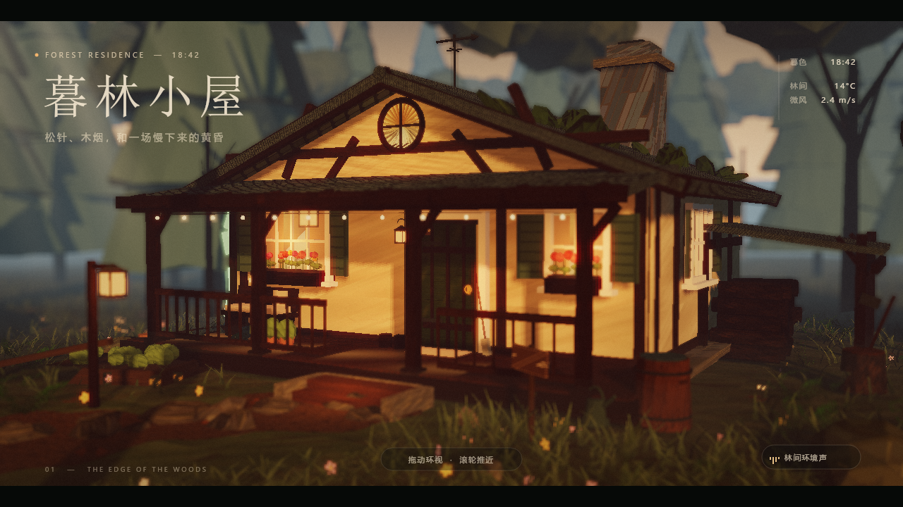

# 暮林小屋 · A Cottage in the Woods

黄昏松林中的一间乡村木屋。一个完全程序化的 Three.js 3D 场景，单文件、可离线运行。

**Live Demo** · [__LIVE_URL__](__LIVE_URL__)



## 亮点

- 全程序化场景：松林、木屋、石基、花箱、木柴棚、炊烟、薄雾、萤火虫、落叶与尘埃均由代码生成，不依赖外部模型或贴图。
- 电影感画面：ACES 色调映射、暖冷对比、体积光、Bloom、景深、暗角、胶片颗粒与 2.39:1 黑边。
- 可交互：拖动环视、滚轮 / 双指推近、开场推镜，以及风、落叶、虫鸣和猫头鹰组成的环境声。
- 工程稳健：WebGL 初始化或后处理失败时自动降级轻量模式；单文件约 636KB，离线也能打开。

## 技术栈

Three.js r162 · WebGL2 · GLSL · Canvas 程序化纹理 · PMREM · EffectComposer · UnrealBloomPass · BokehPass · OrbitControls

## 本地运行

双击 `index.html`，或在当前目录启动一个静态服务器：

```bash
python -m http.server 8000
```

然后访问 <http://localhost:8000>。

## 操作

- 拖动：环视小屋与林间
- 滚轮 / 双指：推近或拉远
- 右下角按钮：开启 / 关闭环境声

## 说明

所有素材均由代码实时生成；页面不发起网络请求，也不依赖外部图片。
